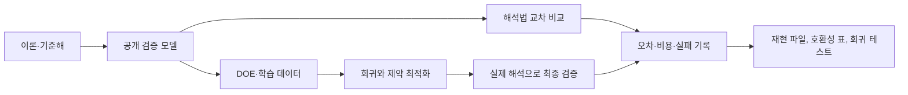

# FEMlab 연구 로드맵

## 공통 모델에서 해석법을 비교한다

정확도는 **문제, 비교할 물리량, 기준해, 해상도, 허용오차**를 지정해야 비교할 수 있다. 선형 정적 브래킷에서 최대 응력이 잘 맞는 해석기가 파동의 위상이나 큰 변형의 접촉력을 가장 잘 예측한다고 볼 근거는 없다. FEM, MPM은 공간 이산화 방식이고, Newmark·Bathe는 시간적분법, Gauss 구적법은 적분 도구, 직접·반복법은 대수 해법이다. 한 프로그램이 이 선택지를 조합한다.

제품 기본 화면은 다섯 작업 유형이면 충분하다. **선형 정적, 모달·선형 동역학, 암시적 비선형·과도, 명시적 동역학, 입자 기반 MPM**을 둔다. 같은 입력·출력과 오차 기준에서 새 방법이 기존 방법을 대체할 수 있는 경우 기본값을 바꾼다. 검증에 쓴 단순한 방법은 회귀 기준으로 남긴다. 예를 들어 Newmark 평균가속도법은 무감쇠 선형 문제의 기준, 중앙차분법은 명시적 파동 해석의 기준에 유용하다. 상세 식·적용 한계·비교표는 [솔버와 벤치마크](solver-benchmarks.ko.md)에 있다.

첫 실측에서 FEMlab 1D 봉과 CalculiX 3D 요소의 축 인장 변위·반력은 해석해와 일치했다. 실제 입력 파일, 파일 출력 정밀도와 결과 수치는 [축 인장봉 교차 검증](axial-bar-reproduction.ko.md)에 있다.

## 실험을 네 작업으로 진행한다

| 작업 | 검증 단위 | 첫 완료 기준 |
|---|---|---|
| 공간 이산화 및 구적 | 1D 보/봉의 해석해, affine patch, 구적점과 메시 세분화 | 변위·반력·적분값에 대해 미리 정한 오차와 수렴 관찰을 기록한다. |
| 시간적분 | 같은 SDOF·파동 문제에 Newmark·중앙차분 기준선과 Bathe 계열 | 시간 간격별 위상·진폭·총 에너지, 같은 오차에 필요한 전체 계산 비용을 비교한다. |
| 입자 기반 | 균일 이동·탄성파·2D 전달, grid crossing | 같은 적용 가정에서 해석해, 보존량, 공간·시간 세분화 변화량을 확인한다. |
| 최적설계 | 브래킷 질량 최소화, 변위·영역 응력 제한 | 같은 고충실도 평가 예산에서 Ridge·Kriging과 기준법을 비교하고 최종 후보를 실제 해석으로 평가한다. |

각 작업은 독립된 이슈와 재현 모델을 유지한다. 공통 결과에는 `case_id`, 입력 해시, 재료·하중·단위, 이산화·시간간격, 요소·구적·적분기·솔버 버전, 관심 물리량의 위치·성분, 수렴 상태, 시간과 메모리를 기록한다. 검증 기준은 해석해 → 제조해 → 수렴된 수치해 순으로 목적에 맞게 택한다. 실험 데이터가 있으면 별도로 물리 모델을 검증한다. 형상, 구속, 질량행렬, 결과 회복 위치가 다른 비교는 차이를 기술한다. [제조해를 이용한 검증](https://doi.org/10.1115/1.1436090)

실제 구현 순서는 동시에 개발 가능한 작업과 선행 검증이 필요한 작업을 구분한다. 브래킷 정적 검증·SDOF 적분·DOE 코드 실험은 병렬 진행할 수 있다. 대리모델 학습에는 검증된 물리량이 선행하며, 결과 재현에는 입력·솔버 식별이 선행한다. [Kriging·과적합·최적설계](surrogate-optimization.ko.md)

## 결과를 공개하는 단위

공개할 첫 단위는 **결과가 달라지는 작은 문제 하나**다. 예컨대 동일한 메시의 브래킷에서 구속 한 줄을 바꾸고 반력과 관측점 변위가 얼마나 달라지는지 보여준다. 초기에는 공개 가능한 합성 모델·독립 계산 입력을 사용한다. 다음 항목을 문제마다 연결한다.

1. **규칙과 이론.** DOI 또는 공식 문서 버전, 식·절 번호, 변수 정의, 단위, 성립 가정을 적는다. 논문 식과 구현의 인덱스·기본값 차이를 기록한다.
2. **재현.** 입력과 예상 해, 재실행 명령, 허용오차, 원시 결과의 위치를 기록한다. 구현 전 아이디어, 코드 검증, 제품 실행 실측은 각각의 증거를 붙인다.
3. **실패와 호환성.** 결과가 어긋나면 한 줄의 키워드나 하나의 하중, 요소를 남겨 최소 재현을 만들고 공개 이슈와 회귀 테스트를 잇는다. 해당 파일의 공유 권한을 확인한다. 통과한 사례가 호환성 표에 추가된다.
4. **사용 증거.** README에서 짧게 결과를 보여준 뒤 입력과 재실행으로 이어지게 한다. 별 수와 함께 외부 재현, 새 테스트 사례, 외부 프로젝트의 수정 채택을 기록한다. 보여주는 오차와 성능은 측정한 사례에 귀속한다.

미공개 연구 데이터와 공동 작업 자료는 공개 가능 범위가 정해진 실험에 사용한다. 이 문서는 연구 설계다. 이 문서에서 제안한 상용·오픈 솔버 간 순위, 신규 Kriging 최적화, 제품 성능은 이 문서 작성 시점에 새로 실측하지 않았다.
